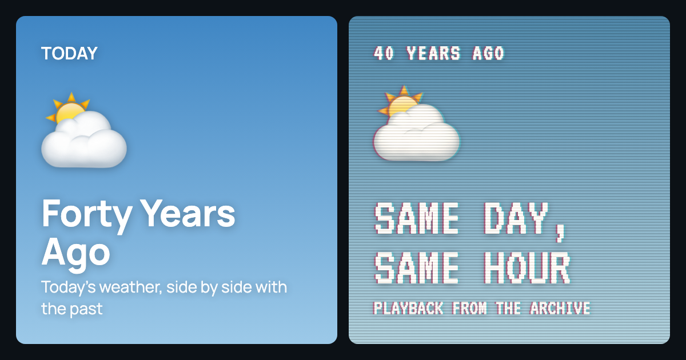

# Forty Years Ago

Today's weather, side by side with the same hour forty years ago.

**Live:** https://elanbw.github.io/forty-years-ago/



## What it does

Open the page and you see two panels for your city. On the left is the weather right now. On the right is the weather at the same hour on the same date forty years ago, styled like an old VHS tape. A line underneath tells you how much warmer or cooler it is than it was then.

- Each panel's sky comes from the real conditions: gradients for clear or overcast, and animated clouds, rain, snow, stars and lightning.
- Shows the current temperature, the day's high and low, and precipitation since midnight, for both now and then.
- Search for any city, or tap the crosshair to use your current location.
- Add more cities to compare in rows. Your list is saved in the browser for next time.
- Opens on Boulder, Colorado for first-time visitors.

## How it's built

The whole app is one static `index.html` file (about 500 lines) with no framework, no build step, no dependencies and no API keys. GitHub Pages serves it straight from `main`.

- **Data:** [Open-Meteo](https://open-meteo.com/) for the current forecast, the historical archive and city search. [BigDataCloud](https://www.bigdatacloud.com/)'s free client-side reverse geocoding turns "use my location" coordinates into a place name.
- **Animation:** each sky is a `<canvas>`. A single `requestAnimationFrame` loop draws every panel. An `IntersectionObserver` skips panels that are off screen, so extra cities cost little.
- **Correctness details:**
  - Every load gets a ticket number, so a slow, older request can't overwrite a newer search in the same row.
  - February 29 falls back to February 28 when the year forty years back wasn't a leap year.
  - Precipitation "so far" sums the hourly totals from midnight to the current hour in the city's own time zone.
- **Resilience:** a city is saved before its weather is fetched, so a slow or failed load doesn't drop it from your list. If the saved list goes missing, the page falls back to your top city and then to Boulder.
- **Accessibility and polish:**
  - Respects `prefers-reduced-motion` and the system light or dark theme.
  - Keeps the two panels side by side on phones.
  - Avoids iOS Safari's zoom-on-focus.
  - Includes Open Graph tags for link previews.

## Run it locally

Any static file server works:

```sh
git clone https://github.com/elanbw/forty-years-ago.git
cd forty-years-ago
python3 -m http.server 8000
```

Then open http://localhost:8000. Location lookup needs `localhost` or HTTPS.

To change the comparison, edit the constants at the top of the script: `YEARS_BACK`, `UNIT` (`"fahrenheit"` or `"celsius"`) and `RAIN_UNIT` (`"inch"` or `"mm"`).

## Credits

Weather data by [Open-Meteo.com](https://open-meteo.com/) (CC BY 4.0). Reverse geocoding by [BigDataCloud](https://www.bigdatacloud.com/).
